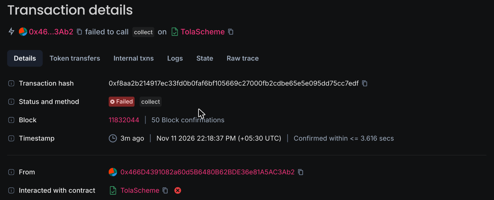
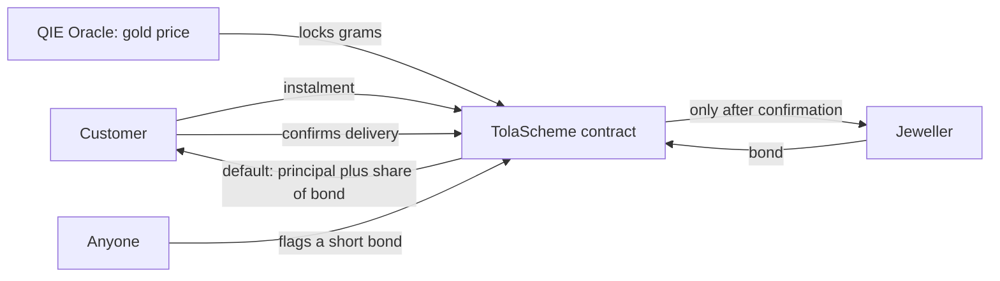

# Tola

**Gold savings your jeweller can't run away with.** A jeweller's monthly gold plan on QIE, where your money stays locked until you have your jewellery.

| | |
|---|---|
| Live app | https://ritesh59697.github.io/tola/ |
| Demo video (2.5 min) | https://ritesh59697.github.io/tola/tola-demo.mp4 |
| Registry on QIE Mainnet | [0x3884E9449F89Bcfb3aaC4667eBEf4E09536B3A60](https://mainnet.qie.digital/address/0x3884E9449F89Bcfb3aaC4667eBEf4E09536B3A60) |
| A jeweller's attempt failing on-chain | [0xf8aa2b21…cc7edf](https://mainnet.qie.digital/tx/0xf8aa2b214917ec33fd0b0faf6bf105669c27000fb2cdbe65e5e095dd75cc7edf): reverted with `CustomerHasNotConfirmed(1)` |

Track: **Commerce & Real World**. QIE Hackathon 3.0. Built by Ritesh, a student, solo.

The demo video was recorded by script on the live site against QIE Mainnet, with a synthetic voice and captions. Every transaction in it is real; see [scripts/video](scripts/video).



A real attempt on QIE Mainnet by the jeweller to take a customer's instalments. It reverted with `CustomerHasNotConfirmed(1)`. All three contracts' source is verified on the explorer.

## The problem

Families across India save for weddings through jewellers' monthly gold plans. The money goes straight to the shop. When a shop fails, customers are left with a claim on a closed business.

In 2019, the owners of [Goodwin Jewellers](https://www.theweek.in/news/biz-tech/2019/10/28/case-untraceable-keralite-promoters-goodwin-jewellers-thane.html) reportedly vanished, with about 700 people owed Rs 21 crore. A legal expert [said at the time](https://in.fashionnetwork.com/news/Goodwin-Jewellers-case-highlights-risk-of-gold-investments,1154582.html) that customers of such schemes had no legal protection if the business was liquidated.

## What it does

The plan works like the one a customer already knows, with one change: the money waits in a contract.

- **Your money stays locked.** The jeweller is paid only after you confirm you received your jewellery. Any attempt before that fails on the chain.
- **Your gold price is fixed the day you pay.** Each instalment locks a weight of gold at QIE Oracle's live price.
- **The jeweller stands behind the gold.** A bond covers your gold gain and bonus, and the required bond rises as gold rises.
- **Anyone can keep watch.** Anyone can flag a short bond. If it isn't repaired in time, customers take back all they paid, plus a share of the bond for gold gains.
- **If nothing is delivered, you take cash.** After the delivery window, you can take your gold's value at the current price.

**Guaranteed:** the principal you paid in. **Covered as far as the bond goes:** your gold gain.

## How it works



There's no backend, no owner, no admin key and no upgrade path. See the [code walkthrough](docs/WALKTHROUGH.md).

## QIE products used

| Product | How it's used | If you removed it |
|---|---|---|
| **QIE Oracle** | `latestRoundData` on the XAUt feed locks each instalment's grams and sets the required bond | Tola has no gold price, so no product |
| **QUSDC** | Instalments and bonds are held in it | No money to lock |
| **QIE Wallet** | Found through EIP-6963 (`me.qiewallet`) first, per QIE's integration guide | Other wallets still work |
| **QIE ID** | `.qie` names are shown for jewellers through the reverse resolver, only if they resolve back to the same address | Addresses show instead |
| **QIEDEX** | In-app swap from QIE to QUSDC, with live quotes from `getAmountsOut` | Customers must swap elsewhere |

**Not used: QIE Pass.** We found no public contract to read, and we won't show a verification badge we can't verify.

## Engineering worth checking

- **60 tests**, including 4 invariants over random action sequences and a fork test against the real gold feed and QUSDC. The main invariant is that the contract always holds what its books say it owes. Run `forge test` in `contracts/`.
- **Oracle failure can't trap customers.** `exit` never reads the oracle, and the feed read is wrapped so a broken feed can't block default or claims.
- **Price age is measured, not guessed.** The deploy script reads the feed's real history and sets the tolerance from the longest gap between updates.
- **Default can't be blocked by plan count.** Gains are added up in batches, by anyone.
- **Limits on jewellers.** The registry caps exit fees and price age and sets a minimum bond, so a shop can't hollow out the promise.

## Notes for the QIE team

Things found while building, in case they're useful:

1. The gold feed's docs say it updates "every few minutes". On 2026-11-09 the longest gap across its last 100 rounds was about 56 hours, and one recent gap was 9.6 hours. It may pause when markets close. Worth stating in the docs, since contracts using a short staleness check would stop working.
2. The gold feed doesn't exist on testnet (1983), so oracle apps can't be tested there as the quickstart suggests.
3. `qie-lend-sdk`'s README labels `0x3EcD…E542` as QUSDC, but it's the lending market's `qQUSDC` token. QUSDC is `0x3F43…5DA5`.
4. The site says 2M+ transactions; the explorer's stats API showed 527,694 on 2026-11-09.

## Known limits

This is a hackathon project. The contracts have no outside audit, and no real jeweller uses it yet. Listed plans use small demo amounts.

- **Delivery is the customer's word.** The contract can't see jewellery, so a shop needs a process where the customer confirms as the piece is handed over.
- **Customers hold a free option.** They can leave at a small fee if gold falls and stay if it rises. A real scheme may need a higher fee or a minimum term.
- **QUSDC is assumed to be worth $1.** Fee-on-transfer tokens aren't supported.
- **Rupee on-ramp is missing,** which is the biggest gap to real families using it.
- **Regulation.** Indian rules on jewellers' schemes need legal review. We don't claim compliance.
- **Prices are international spot,** not an Indian shop's rate with duty, GST and making charges.

## Built with AI assistance

Built with Claude Code. Ritesh reviewed the code and can explain and maintain it, as QIE's FAQ asks. See [the walkthrough](docs/WALKTHROUGH.md).

## Run it

```bash
scripts/setup.sh
```

```bash
cd contracts && forge test
```

```bash
anvil --fork-url https://rpc1mainnet.qie.digital --chain-id 31990 --block-time 3
```

```bash
scripts/local-fork.sh
```

```bash
cd app && VITE_CHAIN_ID=31990 npm run dev
```

Mainnet steps are in [docs/LAUNCH.md](docs/LAUNCH.md).
